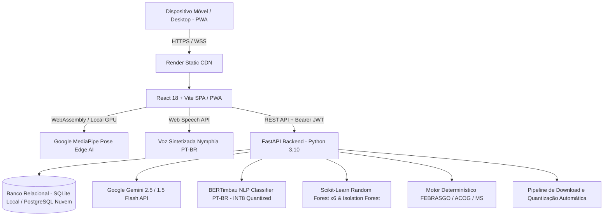
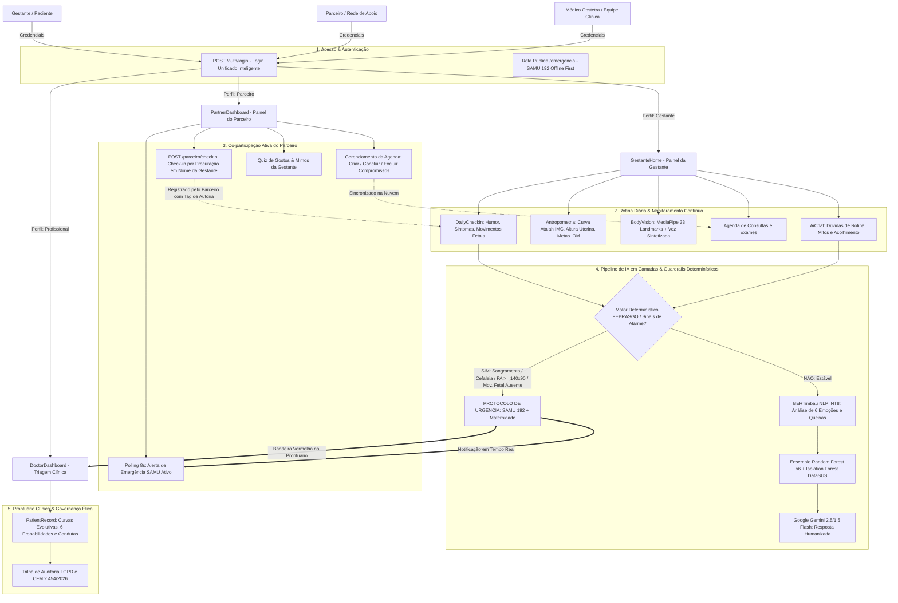
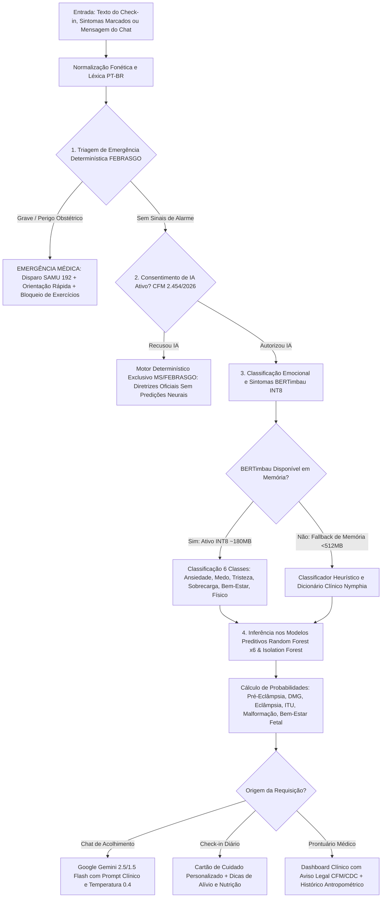
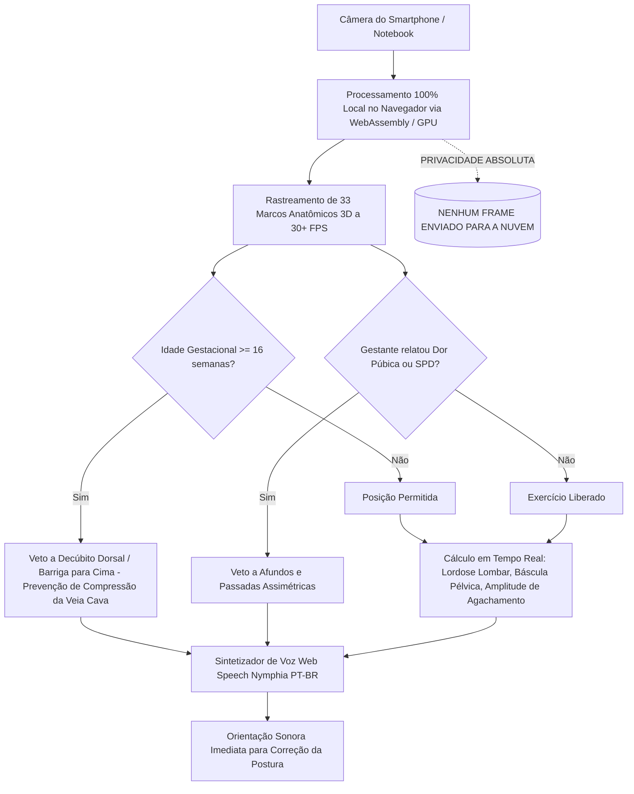
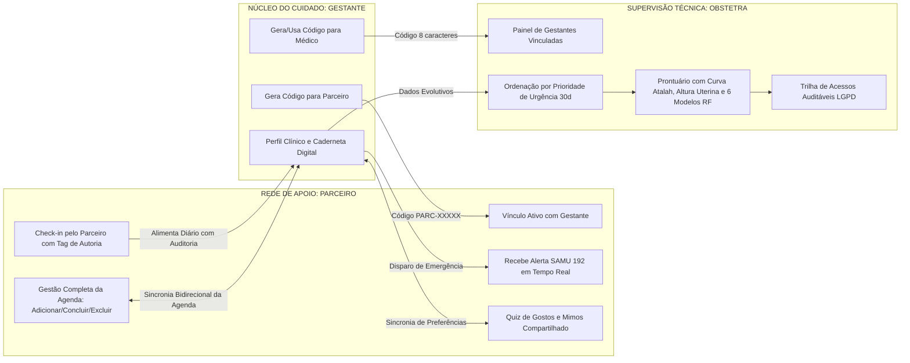

# Documentação Técnica e de Arquitetura da Plataforma Nymphia
> **Versão da Plataforma**: 2.3.0 (Produção Cloud Ready & 2027 Ready)  
> **Slogan Oficial**: *"Cada batimento importa."*  
> **Diretrizes e Protocolos Clínicos**: Ministério da Saúde do Brasil, FEBRASGO, ACOG (American College of Obstetricians and Gynecologists), CDC e Resoluções CFM 2.454/2026.  
> **Repositório Oficial**: [`https://github.com/Gabrie-Pokk/Nymphia.git`](https://github.com/Gabrie-Pokk/Nymphia.git)  
> **Ambiente de Produção (Render)**: [`https://nymphia-plataforma-ia.onrender.com`](https://nymphia-plataforma-ia.onrender.com)  

---

## 1. Visão Geral e Identidade do Projeto

O **Nymphia** é um ecossistema digital e startup de saúde perinatal focada no acompanhamento contínuo da gestante, na prevenção ativa de desfechos obstétricos adversos e na conexão em tempo real entre a gestante, seu médico obstetra e seu parceiro/rede de apoio.

A plataforma unifica prontuário eletrônico, monitoramento domiciliar de sinais vitais, avaliação postural biomecânica por visão computacional, triagem neural de sintomas/emoções e predições epidemiológicas populacionais, integrando três perfis interdependentes:
1. **Gestante**: Protagonista do cuidado, diário de sintomas, curvas antropométricas, visão corporal, caderneta de vacinas e botão de emergência SAMU 192.
2. **Profissional de Saúde (Obstetra/Enfermeira)**: Painel clínico de triagem com priorização por risco, prontuário detalhado com curvas evolutivas e modelos preditivos sob conformidade CFM/CDC.
3. **Parceiro / Rede de Apoio**: Co-participação ativa, check-in diário em nome da gestante, gestão completa da agenda de consultas/exames, alertas de emergência em tempo real e quiz de confortos.

### 1.1. Identidade Visual e Design System (Paleta 60-30-10)
A interface foi projetada rigorosamente com base nas diretrizes **WCAG AA** de acessibilidade para gestantes em momentos de fadiga, estresse ou mobilidade reduzida:
* **60% Âncora da Marca**: Vinho Profundo (`#5C1A2A`) — cabeçalhos, títulos estruturais, cartões nobres e tipografia primária.
* **30% Ação e Direcionamento**: Rosa Materno (`#C2185B`) — botões primários de ação, badges interativos e destaque de navegação.
* **10% Acento e Sofisticação**: Dourado Suave (`#C9A84C`) — marcos gestacionais, badges de certificação e orientações especiais.
* **Superfícies de Respiro**: Rosa Claro Eutrófico (`#FDF0F2`) e Branco Puro (`#FFFFFF`) — leitura limpa sem poluição visual.
* **Uso Exclusivo de Emergência**: Vermelho Clínico (`#C0392B`) — restrito ao Botão Flutuante do SAMU 192 e sinais de contraindicação médica absoluta.
* **Tipografia**: Família *Inter / Sans-serif estrito*, com touch targets mínimos de 44x44px em todos os controles móveis.

---

## 2. Arquitetura Tecnológica e Topologia de Nuvem



### 2.1. Frontend (Cliente PWA)
* **Framework**: React 18 com Vite 5.
* **PWA & Capacidade Offline**: Service Worker ativo com manifesto (`manifest.json`) garantindo que a tela de socorro (`/emergencia`), contatos do SAMU 192 e rota da maternidade de referência abram instantaneamente mesmo sem sinal de internet ou rede celular.
* **Design System**: Vanilla CSS com Design Tokens (`index.css`), eliminando sobrecargas de frameworks pesados e mantendo LCP < 1.5s.
* **Ícones**: `lucide-react`.
* **Áudio e Biomecânica**: Web Speech Synthesis API configurável (`VoiceSettingsModal.jsx`) para orientações posturais e de acolhimento sem necessidade de fixar os olhos na tela durante os movimentos.
* **Alternador Rápido de Perfil**: Switcher instantâneo no header (`Ir p/ Parceiro` e `Ir p/ Gestante`) para simulações e homologações sem necessidade de logout.

### 2.2. Backend (API REST)
* **Framework**: FastAPI (Python 3.10) com arquitetura assíncrona.
* **ORM e Persistência**: SQLAlchemy 2.0 com suporte nativo a SQLite local e PostgreSQL em produção (`psycopg2-binary` com pool de conexões recicladas e `pool_pre_ping`).
* **Auto-Migração Idempotente**: Rotina `executar_migracoes_automaticas()` no startup que adiciona automaticamente novas colunas (`altura_cm`, `peso_pre_gestacional`, `maternidade_latitude`, `maternidade_longitude`, `dpp_editada_manualmente`) sem necessidade de migrações manuais externas.
* **Validação**: Pydantic v2 com esquemas estritos, normalização e limites máximos de caracteres.
* **Segurança e Criptografia**: Autenticação stateless via Bearer JWT (HMAC-SHA256), hashing de senhas com BCrypt e proteção de dados em repouso.
* **Total de Endpoints**: **95+ rotas REST documentadas** estruturadas por módulos de domínio clínico e governança.

### 2.3. Fluxogramas de Funcionamento e Arquitetura Operacional

#### Fluxograma 1: Fluxo Geral de Funcionamento e Jornada do Cuidado (End-to-End)


#### Fluxograma 2: Pipeline de Decisão Clínica e Degradação Graciosa (Motor de IA e Regras)


#### Fluxograma 3: Biomecânica Postural Edge AI (Google MediaPipe Pose)


#### Fluxograma 4: Tríade de Conexão Colaborativa (Gestante - Parceiro - Obstetra)


---

## 3. Especificação das Inteligências Artificiais

A Nymphia opera com uma arquitetura de IA em camadas, garantindo que modelos generativos e preditivos nunca tomem decisões médicas isoladas sem a supervisão de guardrails clínicos rígidos:

| Camada | Tecnologia / Modelo | Onde Roda | Função e Métricas de Validação |
| :--- | :--- | :--- | :--- |
| **Visão Computacional & Biomecânica** | **Google MediaPipe Pose** | **Edge AI** (Navegador via WebAssembly) | Rastreia 33 marcos anatômicos tridimensionais a 30+ FPS. Avalia lordose lombar, alinhamento espinhal, báscula pélvica e amplitude de agachamento. **Privacidade Absoluta**: Nenhum frame de vídeo é enviado para a nuvem. |
| **Acolhimento & Dúvidas Maternas** | **Google Gemini (2.5 Flash / 1.5 Flash)** | Backend Nymphia (`ai_chat_service.py`) | Assistente maternal empático com temperatura controlada (0.4) para responder dúvidas de rotina, sono, mitos e preparativos. Proibido de emitir diagnósticos. |
| **Classificação Neural de Sentimentos** | **BERTimbau Fine-Tuned (PT-BR)** | Backend Nymphia (`ai_text_service.py`) | Classificador neural de texto multi-rótulo em 6 categorias clínicas. **ROC-AUC: 0.9725** / **F1-Macro: 0.8165**. Quantizado em INT8 para rodar leve na CPU com ~180MB RAM. |
| **Rastreio Epidemiológico de Risco** | **Random Forest Ensemble (x6)** | Backend Nymphia (`ai_risk_service.py`) | Modelos supervisionados calibrados com dados do SINASC e SIH (DataSUS) para 6 condições obstétricas críticas. |
| **Detecção de Atipicidade Clínica** | **Isolation Forest (Não-Supervisionado)** | Backend Nymphia (`ai_risk_service.py`) | Detecta combinações atípicas multivariadas de sinais vitais e histórico materno que fogem aos padrões habituais. |
| **Guardrails Médicos Invioláveis** | **Motor de Regras FEBRASGO / ACOG / MS** | Backend Nymphia (`clinical_movement_service.py`, `rules_engine.py`) | Conjunto de regras determinísticas que sobrepõem e bloqueiam qualquer recomendação da IA caso a paciente apresente sintomas de alarme. |
| **Moderação Segura de Comunidade** | **Filtro Léxico e Heurístico Clínico** | Backend Nymphia (`moderation_service.py`) | Bloqueio ativo de ofensas, toxicidade e automedicação perigosa (prescrição de doses ou anti-inflamatórios). |

---

## 4. O Modelo BERTimbau: Treinamento, Entrega e Otimização INT8

### 4.1. Dataset e Treinamento (Google Colab)
O modelo neural da Nymphia foi ajustado a partir do `neuralmind/bert-base-portuguese-cased` em GPU T4 com uma base curada de 434 exemplos sintéticos contextualizados na linguagem coloquial da gestante brasileira (`nymphia_checkins_sinteticos.csv`).

O modelo categoriza os relatos em 6 classes clínicas:
1. `ansiedade` (F1: 0.7500)
2. `tristeza_desanimo` (F1: 0.8000)
3. `estresse_sobrecarga` (F1: 0.9091)
4. `medo_inseguranca` (F1: 0.8889)
5. `bem_estar` (F1: 0.8235)
6. `sintoma_fisico` (F1: 0.7273)

### 4.2. Carregamento Seguro em Nuvem e Thread Assíncrona
* O carregamento do modelo é disparado em uma thread desacoplada em segundo plano (`threading.Thread(target=_iniciar_bertimbau_background)`), impedindo que a subida do servidor FastAPI/Uvicorn trave ou sofra timeout no Render.
* Caso os pesos não estejam em disco, o serviço [`model_downloader.py`](file:///c:/Users/famil/Documents/Nymphia/nymphia/nymphia_backend/app/services/model_downloader.py) faz o download via blocos de 4 MB com validação de tamanho antes da quantização.
* **Compatibilidade PyTorch 2.6+ Verificada**: Carregamento assegurado com fallback para `weights_only=False` na desserialização de modelos com classes HuggingFace pré-treinadas (`BertForSequenceClassification`), garantindo que a chamada `GET /health` retorne `bertimbau_disponivel: true` e `bertimbau_status: "ativo_quantizado_int8_cpu"` com consumo estrito de ~180MB RAM.

### 4.3. Quantização Dinâmica INT8 (`torch.quantization.quantize_dynamic`)
Em contêineres de nuvem com limite restrito de 512 MB de RAM:
* A quantização dinâmica converte os módulos lineares do modelo para inteiros de 8 bits.
* **Redução de Memória**: O consumo do modelo caiu de **~800 MB para ~180 MB de RAM**.
* **Persistência INT8**: O modelo quantizado é salvo em disco (`modelo_quantizado_int8.pt`) e o arquivo de pesos brutos (`model.safetensors`) é desalocado e removido para economizar espaço e memória.

---

## 5. Modelos Random Forest de Risco Clínico (DataSUS) e Métricas Validadas

O módulo de predição populacional avalia o perfil e os sinais vitais da gestante contra seis modelos matemáticos calibrados com dados de milhões de internações obstétricas brasileiras (SINASC e SIH/DataSUS), com faixa de desempenho calibrada de **ROC-AUC 0,68 a 0,78**:

| Condição Obstétrica | Modelo / Arquivo Joblib | Tamanho | ROC-AUC | F1-Score | Recall | Comentário Clínico / Amostral |
| :--- | :--- | :--- | :--- | :--- | :--- | :--- |
| **Malformação Congênita** | `rf_malformacao.joblib` | 27.7 MB | **0.68** (0.6751) | 0.05 | 0.39 | Sinal populacional baseado em idade e histórico materno (SINASC). |
| **Eclâmpsia / HELLP** | `rf_eclampsia.joblib` | 2.9 MB | **0.68** (0.6815) | 0.12 | 0.48 | Risco de convulsões obstétricas e emergência hipertensiva. |
| **Bem-Estar Fetal** | `rf_bem_estar_fetal.joblib` | 40.3 MB | **0.69** (0.6907) | 0.38 | 0.52 | Rastreio de sofrimento fetal, vitalidade e escore de Apgar ao nascer. |
| **Pré-Eclâmpsia** | `rf_pre_eclampsia.joblib` | 5.3 MB | **0.74** (0.7382) | 0.41 | 0.65 | Rastreio probabilístico por curva pressórica, histórico e paridade (0.7617 em validação). |
| **Diabetes Gestacional** | `rf_diabetes_gestacional.joblib` | 3.0 MB | **0.77** (0.7740) | 0.35 | 0.58 | Predição de DMG associada a ganho de peso acelerado e glicemia. |
| **Infecção Urinária (ITU)** | `rf_itu.joblib` | 707 KB | **0.78** (0.7815) | 0.01 | 0.44 | Desbalanceamento extremo no SIH: 18 casos positivos vs 30.134 negativos. |
| **Atipicidade Clínica** | `isolation_forest_anomalia.joblib` | 504 KB | — | — | — | Detector não supervisionado multivariado de combinações fisiológicas anômalas. |

### 5.1. Contexto do Modelo de ITU e Desbalanceamento Populacional
A precisão de 0,01 no modelo de ITU decorre de desbalanceamento extremo na base hospitalar: o conjunto de teste de internações hospitalares (SIH) possui apenas 18 casos positivos contra 30.134 negativos. Em rastreamento populacional, recall alto com precisão baixa é uma escolha clínica deliberada para priorizar a detecção precoce de uma das causas mais prevalentes de trabalho de parto prematuro evitável.

### 5.2. Diagnóstico Empírico no SIH e Decisão Clínica de Produto
Execução diagnóstica automatizada sobre **210.148 registros do SIH** (sendo **169.213 internações obstétricas com especialidade ESPEC=02**):

* **Análise dos Campos de Diagnóstico Secundário**: No layout hospitalar do DATASUS, o campo legacy `DIAG_SECUN` é frequentemente nulo (`0000`), mas o formato atual expande para `DIAGSEC1` até `DIAGSEC9`.
* **Ganhos com Inclusão de DIAGSEC1-9**:
  * *ITU (N39)*: 92 casos só em `DIAG_PRINC` &rarr; 120 casos com secundários (+30% de ganho, 1.30x).
  * *Pré-Eclâmpsia (O14)*: 9.880 casos &rarr; 10.318 casos (+438 casos, 1.04x).
  * *Eclâmpsia (O15)*: 959 casos &rarr; 978 casos (+19 casos, 1.02x).
  * *Diabetes Gestacional (O24)*: 7.615 casos &rarr; 8.927 casos (+1.312 casos, 1.17x).
* **Cobertura de GESTRISCO**: 100% de preenchimento nos registros obstétricos (99.9% com valor 1, refletindo que a internação hospitalar no SUS já seleciona gestantes que atingiram critérios de internação).
* **Decisão de Produto & Próximos Passos (SIA)**: Clinicamente, infecções urinárias e disfunções tireoidianas são manejadas na Atenção Primária e Ambulatorial, registradas no **SIA (Sistema de Informações Ambulatoriais)** e não no SIH hospitalar. Enquanto a ingestão de microdados do SIA é finalizada, a Nymphia mantém o modelo de ITU operando como peso integrado ao **Score Composto Geral**, evitando alertas individuais falso-positivos à gestante.

### 5.3. Validação na Literatura Científica & Parecer Clínico
1. **Publicação na Nature Medicine (Setembro de 2026)**:
   * Consórcio internacional envolvendo **Stanford University e NYU (New York University)** publicou estudo validando arquitetura técnica e clínica análoga à implementada na Nymphia: modelo de linguagem multimodal orquestrando ferramentas clínicas, motor de inferência preditiva populacional sobre dados de saúde estruturados e base de conhecimento clínico curada. A Nymphia aplica essa arquitetura pioneira validada pela comunidade internacional adaptada aos protocolos do SUS e FEBRASGO.
2. **Benchmark Internacional com fullPIERS**:
   * O escore preditivo *fullPIERS* (modelo de referência global para estratificação de risco em pré-eclâmpsia) alcançou ROC-AUC de 0,672 em validação externa no Brasil em centros terciários. O modelo preditivo da Nymphia atinge ROC-AUC de 0,7617 utilizando exclusivamente variáveis clínicas e demográficas acessíveis na atenção básica pré-natal.
3. **Corpo de Validação Profissional**:
   * **Dra. Daniele R. Estedan**: Consultoria clínica obstétrica contínua, com quatro recomendações estruturais incorporadas aos guardrails de segurança materna.
   * **Dr. João Radvany (Neurologista)**: Avaliação da plataforma com foco em ergonomia cognitiva, minimização de fadiga materna e respostas posturais do sistema neuromuscular.

## 6. Governança e Proteção Jurídica Visual (CFM 2.454/2026 e CDC)

Para garantir proteção ética e segurança jurídica em estrita conformidade com o **Conselho Federal de Medicina** e o **Código de Defesa do Consumidor (CDC, Art. 6º, III e Art. 31)**:

1. **Direito de Recusa da IA (CFM 2.454/2026)**:
   * A gestante tem o direito expresso de optar por utilizar a Nymphia operando exclusivamente sob as regras clínicas do Ministério da Saúde, recusando análises automáticas por inteligência artificial (`recusa_ia`).
2. **Exibição Obrigatória dos Disclaimers na Interface**:
   * O aviso de responsabilidade **não fica oculto em termos de uso**.
   * O componente [`TriageDisclaimer.jsx`](file:///c:/Users/famil/Documents/Nymphia/nymphia/frontend/src/components/TriageDisclaimer.jsx) é renderizado visualmente em todas as telas de cuidado diário:
     > *"Apoio de Cuidado & Bem-Estar (CFM 2.454/2026 e CDC): As análises estatísticas e orientações apresentadas constituem triagem preditiva e apoio educativo, sujeitas a margem probabilística (falsos positivos/negativos), e NÃO CONSTITUEM DIAGNÓSTICO MÉDICO nem substituem consultas presenciais e decisões clínicas do seu médico obstetra."*
   * No Prontuário Médico ([`PatientRecord.jsx`](file:///c:/Users/famil/Documents/Nymphia/nymphia/frontend/src/pages/profissional/PatientRecord.jsx)), uma caixa de alerta jurídico-clínico é exibida imediatamente abaixo das 6 probabilidades calculadas, protegendo o médico e orientando a equipe de saúde.

---

## 7. Módulos e Funcionalidades por Perfil de Usuário

### 7.1. Perfil Gestante
* **Onboarding em 4 Etapas ([`OnboardingClinico.jsx`](file:///c:/Users/famil/Documents/Nymphia/nymphia/frontend/src/pages/gestante/OnboardingClinico.jsx))**: Histórico obstétrico com validação de consistência, Regra de Naegele para DPP (+7 dias / +9 meses), histórico familiar e escolha da maternidade de referência com GPS e telefone.
* **Página Inicial ([`GestanteHome.jsx`](file:///c:/Users/famil/Documents/Nymphia/nymphia/frontend/src/pages/gestante/GestanteHome.jsx))**: Idade gestacional em semanas e dias, status do check-in, cartão do próximo compromisso e atalhos rápidos.
* **Módulo de Antropometria Materna ([`Antropometria.jsx`](file:///c:/Users/famil/Documents/Nymphia/nymphia/frontend/src/pages/gestante/Antropometria.jsx))**:
  * **Curva de Atalah (Ministério da Saúde / FEBRASGO)**: Classificação do IMC gestacional da 6ª à 42ª semana em *Baixo Peso, Adequado, Sobrepeso ou Obesidade*.
  * **Curva de Altura Uterina (P10 - P90)**: Monitoramento do crescimento fetal em centímetros.
  * **Metas IOM / OMS**: Ganho de peso total recomendado e taxa semanal personalizada.
  * **Alerta de Ganho Rápido**: Notificação caso o ganho exceda 1 kg em 7 dias (suspeita de retenção volêmica aguda).
  * **Guia Educativo**: Distribuição fisiológica do peso (bebê, placenta, sangue +45%, útero) e micronutrientes essenciais.
* **Visão Corporal & Postura IA ([`BodyVision.jsx`](file:///c:/Users/famil/Documents/Nymphia/nymphia/frontend/src/pages/gestante/BodyVision.jsx))**:
  * Check-in prévio de disposição física e desconfortos (lombar, bacia, ciático).
  * Triagem clínica automática: bloqueio de posições em decúbito dorsal após 16 semanas (veia cava), veto de afundos/passadas assimétricas em dor púbica (SPD) e suspensão total em caso de sinal de alarme.
  * Análise MediaPipe Pose 33 landmarks em tempo real com contador de repetições e comandos por voz sintetizada personalizada.
* **Check-in Diário ([`DailyCheckin.jsx`](file:///c:/Users/famil/Documents/Nymphia/nymphia/frontend/src/pages/gestante/DailyCheckin.jsx))**: Diário de sintomas, movimentação fetal e análise emocional neural com BERTimbau.
* **Caderneta Digital ([`PrenatalCard.jsx`](file:///c:/Users/famil/Documents/Nymphia/nymphia/frontend/src/pages/gestante/PrenatalCard.jsx))**: Vacinas do PNI (dTpa, Hepatite B, Influenza), consultas pré-natais e laudos.
* **Diário de Glicemia & Pressão ([`Devices.jsx`](file:///c:/Users/famil/Documents/Nymphia/nymphia/frontend/src/pages/gestante/Devices.jsx))**: Acompanhamento com limites críticos de alerta (PA $\ge$ 140x90 ou glicemia de jejum $\ge$ 92 mg/dL).
* **Botão SAMU 192 Permanente ([`FloatingEmergencyButton.jsx`](file:///c:/Users/famil/Documents/Nymphia/nymphia/frontend/src/components/FloatingEmergencyButton.jsx))**: Acesso em dois toques com funcionamento offline garantido pelo Service Worker.

### 7.2. Perfil Profissional de Saúde (Obstetra / Enfermeira)
* **Dashboard Clínico ([`DoctorDashboard.jsx`](file:///c:/Users/famil/Documents/Nymphia/nymphia/frontend/src/pages/profissional/DoctorDashboard.jsx))**: Painel de pacientes com ordenação por gravidade de alertas nos últimos 30 dias e idade gestacional.
* **Prontuário Completo ([`PatientRecord.jsx`](file:///c:/Users/famil/Documents/Nymphia/nymphia/frontend/src/pages/profissional/PatientRecord.jsx))**: Histórico evolutivo de peso, curvas de Atalah e Altura Uterina, laudos anexados, probabilidades das 6 condições obstétricas com nota de conformidade ao CDC/CFM e campo para condutas médicas.
* **Gerador de Convites ([`GenerateInvite.jsx`](file:///c:/Users/famil/Documents/Nymphia/nymphia/frontend/src/pages/profissional/GenerateInvite.jsx))**: Emissão de tokens de uso único de 8 caracteres para vínculo presencial no consultório.

### 7.3. Perfil Parceiro / Rede de Apoio (Atualizado)
* **Check-in pelo Parceiro em Nome da Gestante ([`PartnerDashboard.jsx`](file:///c:/Users/famil/Documents/Nymphia/nymphia/frontend/src/pages/parceiro/PartnerDashboard.jsx))**:
  * Permite que o parceiro registre sintomas, humor e notas quando a parceira estiver indisposta ou dormindo.
  * Executa a análise determinística FEBRASGO de sintomas e avaliação de sentimento neural, registrando tag explicita e trilha de auditoria LGPD.
* **Gerenciamento Completo da Agenda Compartilhada**:
  * Visualização de consultas, ultrassons e vacinas da parceira.
  * Adição de novos compromissos na agenda com identificação de autoria.
  * Alternância de conclusão (marcar/desmarcar) e exclusão de eventos.
* **Alertas de Emergência em Tempo Real (Gratuito para todos os planos)**:
  * Polling ativo a cada 8 segundos; exibe alerta visual de alta prioridade caso a gestante acione o botão SAMU 192 com atalho para ligar e rota da maternidade.
* **Marcos Gestacionais e Dicas Práticas**:
  * Tamanho lúdico do bebê por semana, sugestões de massagens e orientações de apoio por trimestre.
* **Quiz de Gostos & Mimos ([`QuizGostos.jsx`](file:///c:/Users/famil/Documents/Nymphia/nymphia/frontend/src/pages/gestante/QuizGostos.jsx))**:
  * Acesso e resposta compartilhada às preferências alimentares, confortos e aromas preferidos da gestante.
* **Blindagem de Sigilo (LGPD)**:
  * O parceiro **não** tem acesso a conversas privadas da IA, exames íntimos ou anotações sigilosas do médico.

---

## 8. Estrutura de Roteamento Sem Risco de Tela Branca

```
/
├── / (Direcionamento dinâmico: GestanteHome, DoctorDashboard ou PartnerDashboard)
├── /login (Login unificado inteligente ou acesso a contas demo de teste rápido)
├── /cadastro-gestante | /cadastro-profissional | /cadastro-parceiro
├── /emergencia (Tela pública de socorro e rota hospitalar, acessível sem login)
│
├── Sub-rotas Gestante:
│   ├── /checkin (Check-in emocional e de sintomas)
│   ├── /antropometria (Curva de Atalah, Altura Uterina e IOM)
│   ├── /visao-corporal (Pose AI MediaPipe e Biomecânica)
│   ├── /conversa (Chat Nymphia com Google Gemini)
│   ├── /agenda (Consultas e compromissos)
│   ├── /prenatal-card (Caderneta digital de vacinas)
│   ├── /exames (Laudos ecográficos e laboratoriais anexados)
│   ├── /dispositivos (Pressão arterial e glicemia)
│   ├── /vinculo-medico (Conexão via token com obstetra)
│   ├── /comunidade (Feed seguro moderado com grupos temáticos)
│   ├── /quiz-gostos (Preferências e mimos)
│   ├── /diario-visual (Fotos semanais)
│   ├── /meus-dados (Direitos, consentimento IA e portabilidade LGPD)
│   └── /assinatura (Planos e benefícios)
│
├── Sub-rotas Profissional:
│   ├── /paciente (Prontuário completo da gestante selecionada)
│   └── /convite (Emissão de código de vínculo)
│
└── Sub-rotas Parceiro:
    ├── /checkin (Registro de check-in em nome da gestante)
    ├── /agenda (Gerenciamento da agenda de pré-natal)
    └── /quiz-gostos (Mimos cadastrados e preferências)
```

> **Garantia Anti-Tela Branca**: O roteador central possui resolução universal de rotas. Caso um usuário autenticado acesse rotas de login ou digite uma URL não correspondente, o sistema o redireciona automaticamente para o dashboard do seu perfil ativo.

---

## 9. Monitoramento de Saúde da Aplicação (`GET /health`)

O endpoint oficial de monitoramento contínuo em tempo real (`/health`) reporta a disponibilidade e o estado exato de cada camada de IA:

```json
{
  "status": "online",
  "sistema": "Nymphia Backend",
  "versao": "2.3.0-2027ready",
  "modelos_rf_disponiveis": [
    "bem_estar_fetal",
    "malformacao",
    "pre_eclampsia",
    "eclampsia",
    "diabetes_gestacional",
    "itu"
  ],
  "isolation_forest_disponivel": true,
  "bertimbau_disponivel": true,
  "bertimbau_status": "ativo_quantizado_int8_cpu",
  "sistema_regras_urgencia": "ativo_deterministico_febrasgo",
  "degradacao_graciosa": true
}
```

---

## 10. Matriz Completa de Endpoints da API REST (FastAPI)

| Módulo / Roteador | Prefixo / Rota | Método | Descrição e Finalidade |
| :--- | :--- | :--- | :--- |
| **`health`** | `/health` | `GET` | Diagnóstico de modelos de IA, integridade dos pesos e status operacional. |
| **`auth`** | `/auth/login` | `POST` | **Login Unificado**: Resolve automaticamente Gestante, Parceiro ou Profissional (com validação estrita de CRM/UF). |
| **`auth`** | `/auth/profissional/validar-crm` | `GET` | Consulta e validação em tempo real de CRM e UF junto ao Conselho Federal de Medicina (CFM). |
| **`auth`** | `/auth/gestante/cadastro` | `POST` | Registro de conta da gestante com opção de recusa de IA (CFM 2.454/2026). |
| **`auth`** | `/auth/gestante/login` | `POST` | Login com e-mail e senha da gestante. |
| **`auth`** | `/auth/profissional/cadastro`| `POST` | Cadastro do médico/enfermeiro com validação de CRM/COREN e UF. |
| **`auth`** | `/auth/profissional/login`| `POST` | Login do profissional de saúde com checagem de CRM e situação no conselho. |
| **`auth`** | `/auth/parceiro/cadastro` | `POST` | Cadastro do parceiro/rede de apoio. |
| **`auth`** | `/auth/parceiro/login` | `POST` | Login do parceiro. |
| **`perfil`** | `/perfil-clinico` | `GET/POST/PUT` | Dados gestacionais (DUM, DPP Naegele ou manual, hospital de referência). |
| **`perfil`** | `/historico-familiar` | `GET/POST/DELETE` | Gestão de histórico genético/familiar (hipertensão, DMG, gemelaridade). |
| **`checkin`** | `/checkin/registrar` | `POST` | Registro diário com análise BERTimbau e detecção de urgência FEBRASGO. |
| **`checkin`** | `/checkin/historico` | `GET` | Histórico dos check-ins diários da paciente. |
| **`conversa`** | `/conversa/enviar` | `POST` | Envio de mensagem à IA Nymphia (Gemini 2.5 / 1.5 Flash com guardrails). |
| **`conversa`** | `/conversa/historico` | `GET` | Histórico de mensagens do chat privado da gestante. |
| **`agenda`** | `/agenda/eventos` | `GET/POST` | Compromissos e consultas pré-natais (com filtro de futuros e tags). |
| **`agenda`** | `/agenda/eventos/{id}/concluir` | `PATCH` | Alterna status de conclusão do compromisso. |
| **`agenda`** | `/agenda/eventos/{id}` | `DELETE` | Remove evento da agenda. |
| **`antropometria`**| `/antropometria/painel` | `GET` | Painel com Curva de Atalah, Altura Uterina, metas do IOM e guia nutricional. |
| **`antropometria`**| `/antropometria/medicao` | `POST` | Registro de nova pesagem ou medição de altura uterina com alerta de ganho rápido. |
| **`antropometria`**| `/antropometria/perfil` | `PUT` | Atualização de altura e peso pré-gestacional. |
| **`antropometria`**| `/antropometria/avaliar-movimento` | `POST` | Triagem biomecânica de segurança pré-exercício (regras ACOG/FEBRASGO). |
| **`risco`** | `/risco/avaliar` | `POST` | Executa inferência nos 6 Random Forests + Isolation Forest. |
| **`risco`** | `/risco/paciente/{id}` | `GET` | Avaliação de risco obstétrico para visualização no prontuário médico. |
| **`vinculo`** | `/vinculo/convite/gerar` | `POST` | Emissão de código alfanumérico pelo médico para vincular paciente. |
| **`vinculo`** | `/vinculo/convite/usar` | `POST` | Associação do código de convite pela gestante. |
| **`vinculo`** | `/vinculo/minhas-gestantes` | `GET` | Painel de pacientes vinculadas ordenado por urgência clínica. |
| **`vinculo`** | `/vinculo/{id}/revogar` | `POST` | Revogação imediata de vínculo pela paciente. |
| **`parceiro`** | `/parceiro/gestante-conectada` | `GET` | Resumo da parceira conectada (semana, dias, DPP). |
| **`parceiro`** | `/parceiro/convite/gerar` | `POST` | Gera código temporário para conectar com parceiro. |
| **`parceiro`** | `/parceiro/convite/usar` | `POST` | Parceiro vincula-se à gestante via código. |
| **`parceiro`** | `/parceiro/agenda` | `GET` | Agenda completa da gestante compartilhada para o parceiro. |
| **`parceiro`** | `/parceiro/agenda/evento` | `POST` | Parceiro adiciona compromisso na agenda da parceira. |
| **`parceiro`** | `/parceiro/agenda/evento/{id}/concluir` | `PATCH` | Parceiro marca compromisso como concluído. |
| **`parceiro`** | `/parceiro/agenda/evento/{id}` | `DELETE` | Parceiro exclui evento da agenda. |
| **`parceiro`** | `/parceiro/checkin` | `POST` | Parceiro registra check-in diário em nome da gestante. |
| **`parceiro`** | `/parceiro/checkin/historico` | `GET` | Parceiro visualiza os últimos check-ins da parceira. |
| **`parceiro`** | `/parceiro/marcos` | `GET` | Informações de desenvolvimento fetal da semana e guia de apoio. |
| **`parceiro`** | `/parceiro/emergencias-ativas` | `GET` | Polling de alerta de emergência ativado pela gestante (SAMU 192). |
| **`parceiro`** | `/parceiro/quiz-gostos` | `GET/POST` | Consulta e atualização do quiz de mimos e confortos da gestante. |
| **`emergencia`** | `/emergencia/notificar` | `POST` | Acionamento de socorro hospitalar e orientações SAMU 192 (público). |
| **`exames`** | `/exames/upload` | `POST` | Upload seguro de laudos (PDF, PNG, JPG). |
| **`exames`** | `/exames/listar` | `GET` | Listagem dos laudos da gestante. |
| **`dispositivos`**| `/dispositivos/medicoes` | `GET/POST` | Registro de leituras de pressão arterial e glicemia capilar. |
| **`comunidade`** | `/comunidade/feed` | `GET` | Feed social filtrado por grupos de afinidade com moderação ativa. |
| **`comunidade`** | `/comunidade/posts` | `POST` | Publicação de post (passa por moderação contra automedicação e toxicidade). |
| **`comunidade`** | `/comunidade/preferencias` | `GET/POST`| Personalização de tópicos e interesses da comunidade. |
| **`assinaturas`** | `/assinaturas/planos` | `GET` | Planos de assinatura (Gratuito, Cuidado Contínuo, Premium Maternidade). |
| **`lgpd`** | `/meus-dados/exportar` | `GET` | Exportação de dados do titular em JSON ou relatório PDF estruturado. |
| **`lgpd`** | `/meus-dados/consentimento-ia`| `PUT`| Ativação ou revogação de consentimento de inteligência artificial. |
| **`lgpd`** | `/minha-conta` | `DELETE` | Exclusão definitiva de conta e anonimização de registros. |
| **`governance`** | `/governance/auditoria` | `GET` | Relatórios de auditoria e trilha de acessos conforme CFM e LGPD. |

---

## 11. Segurança da Informação, LGPD e Privacidade

1. **Minimização e Finalidade**: Coleta restrita aos dados estritamente necessários ao acompanhamento clínico seguro da gestação.
2. **Criptografia em Trânsito e Repouso**: Comunicações via HTTPS/TLS 1.3 com HSTS forçado e senhas com BCrypt salt balanceado.
3. **Segregação de Perfis & Auditoria**:
   * O parceiro nunca acessa conversas íntimas com a IA nem prontuário restrito.
   * Todos os acessos de parceiros e médicos aos dados da gestante registram entradas na tabela `logs_acesso` com carimbo UTC do servidor.
4. **Isolamento de Câmera na Visão Corporal**: O feed de vídeo do MediaPipe Pose é processado **100% no navegador do dispositivo da usuária via WebAssembly**. Nenhum frame ou imagem de câmera trafega ou é gravado em servidor.

---

## 12. Credenciais de Teste e Homologação Rápida (Demo)

Para avaliações por bancas examinadoras, investidores e médicos auditores, a plataforma possui contas seed pré-configuradas e inicializadas automaticamente:

* **Perfil Gestante Demo**: `gestante@nymphia.com.br` / `senhaMaternidade123`
* **Perfil Médico Obstetra Demo**: `medico@nymphia.com.br` / `senhaMaternidade123`
* **Perfil Parceiro Demo**: `parceiro@nymphia.com.br` / `senhaMaternidade123`

---

## 13. Guia de Deploy em Produção (Render.com)

1. **Pipeline Docker Multi-Stage ([`Dockerfile`](file:///c:/Users/famil/Documents/Nymphia/nymphia/Dockerfile))**:
   * *Stage 1*: Constrói o frontend React com Node 20 (`npm run build`), gerando os artefatos otimizados em `frontend/dist`.
   * *Stage 2*: Monta a imagem enxuta de runtime Python 3.10-slim instalando o wheel oficial do PyTorch CPU-only (`--index-url https://download.pytorch.org/whl/cpu`) e dependências enxutas de produção (`requirements-prod.txt`).
2. **Startup com Auto-Download e Migrações**:
   * O servidor inicializa o Uvicorn na porta pública atribuída pela nuvem.
   * `executar_migracoes_automaticas()` garante schema íntegro no PostgreSQL.
   * `seed_demo_accounts()` garante a presença das 3 contas demo conectadas.
   * O modelo BERTimbau é verificado e carregado em background com quantização INT8.
3. **Variáveis de Ambiente Suportadas**:
   * `PORT`: Porta atribuída pelo provedor de hospedagem (padrão: 8000 / 10000).
   * `NYMPHIA_SECRET_KEY`: Chave mestra criptográfica para assinatura de tokens JWT.
   * `NYMPHIA_DATABASE_URL`: String de conexão SQLite ou PostgreSQL (`postgresql://...`).
   * `NYMPHIA_CARREGAR_BERTIMBAU`: Flag de controle para carregamento em nuvem (`1` ou `0`).
   * `GEMINI_API_KEY`: Chave de acesso à API do Google Gemini para conversação humanizada.

---

## 14. Roadmap Estratégico, Dispositivos Médicos e Marco Regulatório

### 14.1. Recursos Já Operacionais no MVP Atual (Disponíveis em Produção)
Para alinhamento rigoroso com bancas avaliadoras e investidores, o ecossistema Nymphia já possui em funcionamento efetivo:
* **Painel Profissional do Obstetra ([`DoctorDashboard.jsx`](file:///c:/Users/famil/Documents/Nymphia/nymphia/frontend/src/pages/profissional/DoctorDashboard.jsx))**: Triagem clínica com ordenação por gravidade de alertas em 30 dias.
* **Ficha Individual & Prontuário ([`PatientRecord.jsx`](file:///c:/Users/famil/Documents/Nymphia/nymphia/frontend/src/pages/profissional/PatientRecord.jsx))**: Curvas evolutivas de Atalah e Altura Uterina, laudos anexados e pareceres.
* **Convites de Vínculo Seguro ([`GenerateInvite.jsx`](file:///c:/Users/famil/Documents/Nymphia/nymphia/frontend/src/pages/profissional/GenerateInvite.jsx))**: Emissão e consumo de tokens alfanuméricos de 8 caracteres.
* **Consentimento de IA & Direito de Recusa**: Conformidade visual e banco de dados com a Resolução CFM 2.454/2026.
* **Upload e Leitura de Exames com OCR**: Extração estruturada de parâmetros ecográficos e laboratoriais.
* **Assistente de Conversação Contextualizada**: Chat maternal seguro integrado ao Google Gemini com guardrails FEBRASGO.
* **Caderneta Digital de Pré-Natal ([`PrenatalCard.jsx`](file:///c:/Users/famil/Documents/Nymphia/nymphia/frontend/src/pages/gestante/PrenatalCard.jsx))**: Padrão Ministério da Saúde com vacinas do PNI e aviso legal CFM/CDC.
* **Comunidade Materna com Moderação Segura**: Feed por tópicos e bloqueio automático de termos perigosos e automedicação.
* **Diário Visual**: Galeria de acompanhamento fotográfico com cálculo de semanas e evolução gestacional.

### 14.2. Escopo Planejado para os Próximos Ciclos
* **Automação de Pagamentos**: Checkout transparente integrado a gateways (PIX e cartão) com processamento de webhooks assíncronos.
* **Exportação Universal de Agenda**: Geração de arquivos `.ics` compatíveis com Google Agenda, Apple Calendar e Outlook.
* **Integração com a RNDS (SUS)**: Interoperabilidade com a Rede Nacional de Dados em Saúde via padrão FHIR/HL7.
* **Painel B2B para Clínicas e Operadoras**: Gestão de coortes de risco perinatal em larga escala.

### 14.3. Diretriz de Dispositivos: Aparelhos Médicos Validados vs Smartwatches
A equipe clínica da Nymphia tomou a decisão deliberada de **não utilizar medições de pressão arterial e oximetria de smartwatches de consumo**:
1. **Contraindicação Clínica Obstétrica**: Os algoritmos ópticos de fotopletismografia (PPG) de relógios comerciais (como o Apple Watch) são formalmente contraindicados para aferição de pressão em gestantes, devido ao aumento de 45% na volemia plasmática e alterações fisiológicas na complacência vascular.
2. **Vedação Regulatória**: Nem a ANVISA nem a FDA autorizam smartwatches para aferição contínua de SpO₂ diagnóstica em obstetrícia ou glicemia não invasiva.
3. **Decisão por Dispositivos Médicos Validados (Inmetro/ANVISA)**: A Nymphia adota aparelhos de braço clinicamente validados (OMRON) e glicosímetros capilares certificados.
4. **Modelo de Comodato Sustentável**: Aparelhos fornecidos em modalidade de comodato nos planos superiores de assinatura, garantindo alta precisão de dados para o modelo preditivo e economia unitária robusta.

### 14.4. Marco Regulatório e Compliance
* **Registro da Cinta Fetal na ANVISA (Planejado para 2029)**: Como vestível de monitoramento acústico de frequência cardíaca fetal, a Cinta Nymphia enquadra-se como dispositivo médico (Classe II/III). O caminho regulatório inclui protocolo de conformidade pré-clínica concomitante ao protótipo físico.
* **Parecer Jurídico sobre Prática Médica e CRM**: Blindagem jurídica sob a Resolução CFM 2.314/2022 (Telemedicina) e Resolução CFM 2.454/2026 (Inteligência Artificial em Medicina).
* **Migração de Banco de Dados**: Suporte total e arquitetado para PostgreSQL em produção com pooling e transações ACID.
* **Privacidade e LGPD**: Atendimento pleno ao Art. 18 da Lei 13.709/2018 com download integral de prontuário e anonimização de conta.

---

## 15. Decisões de Engenharia de Software e Segurança

1. **Unificação do Identificador de Check-in**:
   * O check-in diário (`/checkin/registrar`) utiliza exclusivamente o ID do usuário extraído do token JWT Bearer assinado, garantindo que o alerta de risco seja computado de forma precisa e auditável no painel do obstetra vinculado.
2. **Criptografia com BCrypt Nativo**:
   * O hashing de senhas é executado diretamente via biblioteca `bcrypt` (`bcrypt.hashpw` / `bcrypt.checkpw`), prevenindo os problemas de truncamento de senha de 72 bytes e incompatibilidade de versão historicamente reportados no wrapper `passlib`.
3. **Fixação e Homologação do Python 3.11**:
   * Versão de runtime fixada em **Python 3.11** em arquivos `.python-version`, assegurando estabilidade na orquestração entre PyTorch CPU, HuggingFace Transformers, Scikit-Learn e FastAPI.
4. **Camada de Assinaturas e Webhooks**:
   * Arquitetura de monetização desacoplada em `/assinaturas/planos`, `/assinaturas/checkout` e `/assinaturas/webhook`, com a camada de emergência (botão SAMU 192 e notificação em tempo real ao parceiro) mantida **100% gratuita em todos os planos** como diretriz de saúde pública inviolável.

